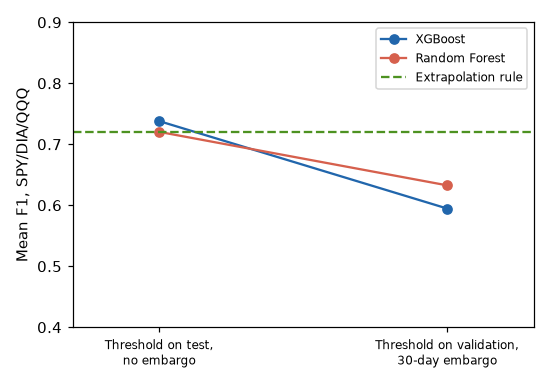
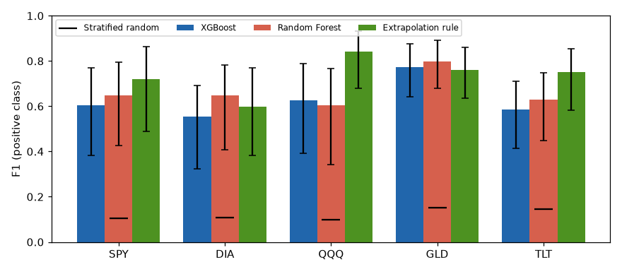

# Golden Cross Transition Classifier

## Question

Can a classifier trained on daily technical features flag, up to 30 trading days in advance,
that the 50-day and 200-day simple moving averages of an ETF are about to cross
(Golden Cross or Death Cross)? And does it do better than simply extrapolating the gap
between the two averages?

A first evaluation gave a mean F1 of 0.74. This repository documents how that number changes
under a stricter protocol, and compares the models with a rule that has no learned parameters.



## Data

- Daily OHLCV from Yahoo Finance (`yfinance`, adjusted prices), 2000-01-03 to 2024-12-30, plus the CBOE VIX.
- Training asset: SPY. Evaluation assets: SPY, DIA, QQQ, GLD, TLT. GLD and TLT start later (2004 and 2002).
- After removing warm-up rows, SPY has 6,084 daily rows. Each asset is split chronologically 75/25:

| Asset | Train rows | Test rows | Test period | Positive rate (train / test) | Crossovers in test |
|-------|-----------:|----------:|-------------|-----------------------------:|-------------------:|
| SPY | 4,563 | 1,521 | 2018-12-13 → 2024-12-30 | 11.6% / 9.9% | 5 |
| DIA | 4,563 | 1,521 | 2018-12-13 → 2024-12-30 | 15.1% / 10.3% | 6 |
| QQQ | 4,563 | 1,521 | 2018-12-13 → 2024-12-30 | 14.4% / 8.7% | 5 |
| GLD | 3,643 | 1,215 | 2020-03-04 → 2024-12-30 | 13.1% / 22.5% | 10 |
| TLT | 4,080 | 1,360 | 2019-08-06 → 2024-12-30 | 20.3% / 19.4% | 9 |

## Method

- **Target.** s_t = 1[MA50 > MA200]. y_t = 1 if s changes within days t+1…t+30.
  Positive labels come in contiguous 30-day blocks, so the SPY test set has 150 positive rows
  but only 5 crossover events.
- **Features (12).** Return, 20-day volatility, 5-day cumulative return, RSI(14), 14-day volume
  rate of change, ATR(14), VIX divided by its 60-day mean, and five moving-average dynamics features
  (MA gap normalized by MA200, MA velocity, MA50 slope, volatility-normalized gap, MA cross momentum).
  All are computed from past data only.
- **Models.** XGBoost (`scale_pos_weight` = negatives/positives) and Random Forest (`class_weight='balanced'`).
  Hyperparameters come from `RandomizedSearchCV` (100 draws, `TimeSeriesSplit(5)`, F1 on the positive class)
  on the SPY training set ([notebooks/02_model_selection.ipynb](notebooks/02_model_selection.ipynb)).
- **Decision threshold.** Selected on the last 20% of the SPY training period (2015-04-30 to 2018-12-12,
  grid 0.10–0.95), with a 30-day embargo before that block. The model is then refit on the full training
  period minus its last 30 rows, whose labels depend on test-period prices.
  Selected thresholds: 0.20 (XGBoost), 0.45 (Random Forest).
- **Baselines.**
  - *Extrapolation rule*: flag day t if extending the 5-day trend of the MA gap reaches zero within 30 days.
    It has no learned parameters; on the SPY training set the best horizon for this rule is also 30 days.
  - *Stratified random*: expected F1 of random predictions at the training positive rate.
- **Transfer.** Models trained on SPY are applied unchanged to the other assets.
- **Uncertainty.** 95% percentile bootstrap, B = 1000, using 30-day moving blocks to respect
  label autocorrelation.

## Results

F1 on the positive class, test set, with 30-day block bootstrap 95% CI.

| Asset | XGBoost | Random Forest | Extrapolation rule | Stratified random |
|-------|--------:|--------------:|-------------------:|------------------:|
| SPY | 0.603 [0.384, 0.771] | 0.647 [0.426, 0.794] | 0.720 [0.489, 0.865] | 0.106 |
| DIA | 0.554 [0.324, 0.692] | 0.648 [0.409, 0.782] | 0.597 [0.382, 0.769] | 0.109 |
| QQQ | 0.627 [0.393, 0.788] | 0.603 [0.341, 0.766] | 0.843 [0.678, 0.931] | 0.099 |
| GLD | 0.774 [0.643, 0.877] | 0.799 [0.679, 0.891] | 0.762 [0.637, 0.860] | 0.153 |
| TLT | 0.586 [0.413, 0.711] | 0.628 [0.448, 0.748] | 0.752 [0.583, 0.853] | 0.145 |
| **Mean SPY/DIA/QQQ** | **0.595** | **0.633** | **0.720** | 0.105 |

- With the threshold selected on the SPY test set instead (the first protocol), the same models
  reach a mean F1 of 0.738 (XGBoost) and 0.720 (Random Forest) over SPY, DIA and QQQ
  ([results/naive_protocol.csv](results/naive_protocol.csv)).
- All methods are well above the random baseline. The extrapolation rule is ahead on SPY, QQQ and TLT,
  Random Forest is ahead on DIA, and both models are ahead on GLD. The block-bootstrap intervals of the
  three methods overlap on every asset.
- Block intervals are 2.6 to 3.7 times wider than intervals that resample individual days.
- Every method raises at least one alert in the 30 days before each of the 35 test crossovers.
  The differences come from false alarms: on SPY, XGBoost flags 291 days, Random Forest 230
  and the extrapolation rule 139, for 150 positive days.
- Walk-forward on SPY (expanding window, 4 usable folds, threshold re-selected in each training window):
  pooled F1 0.651 (XGBoost) and 0.638 (Random Forest). Fold F1 ranges from 0.387 to 0.792 and the
  selected threshold from 0.10 to 0.80.
- Perturbing prices by one part in a million (20 runs) moves the XGBoost mean F1 over SPY/DIA/QQQ
  between 0.596 and 0.643. Random Forest stays within 0.633–0.635 and the extrapolation rule does not change.



## How to run

```bash
pip install -r requirements.txt
python scripts/run_main.py          # main results → results/
python scripts/target_analysis.py   # target study and noise test
python scripts/perturbation.py      # sensitivity to 1e-6 price perturbations
python scripts/make_figures.py      # figures/ (needs run_main first)
```

`run_main.py` takes about 1 minute. The first run downloads the data and caches it in `data/`.
Yahoo Finance returns slightly different adjusted prices from one download to the next, so a fresh
cache can give numbers that differ from the ones above, mostly for XGBoost.

The notebooks show the exploration. `01` covers target selection and noise tests, and `02` the
hyperparameter search and the first evaluation, where thresholds were chosen on the test set.
`03` runs the corrected evaluation. Notebook `01` imports target-exploration functions that are no
longer in `src/features.py`; their current versions are in `src/target.py` and `scripts/target_analysis.py`.

The paper source is in [paper/GC_prediction_paper.tex](paper/GC_prediction_paper.tex).

## Limitations

- **Few events.** Each test set holds 5 to 10 crossovers, so one missed or extra event moves F1 noticeably.
  Model rankings per asset are not statistically supported.
- **Strong simple baseline.** MA200 at t+30 shares 170 of its 200 days with past prices, so the
  target is largely predictable by construction. A linear extrapolation of the MA gap
  beats both models on three of five assets.
- **Threshold instability.** The threshold selected on validation data differs from the one that is best
  on the test period, and it moves widely across walk-forward folds.
- **Numerical sensitivity.** XGBoost results change with perturbations far below price precision,
  probably through `MA_cross_momentum`, which divides by the MA gap.
- **Correlated evaluation assets.** DIA and QQQ are tested over the same dates as SPY and move with it,
  so they are not independent confirmations.
- **Hyperparameter search.** XGBoost early stopping inside the search used the last cross-validation fold,
  which is also scored by the search.
- **Scale-dependent features.** ATR and MA velocity are in price units, which affects transfer across assets.
- **Right censoring.** The last 30 days of each series cannot be labeled positive.
- This is a classification study. It does not evaluate a trading strategy, costs or returns.
